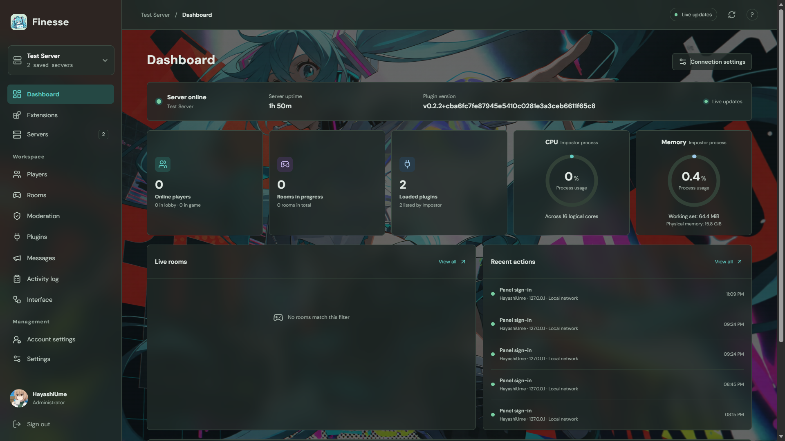

<p align="center">
  
</p>

<h1 align="center">Finesse</h1>

<p align="center">Integrated multi-server management platform for Impostor.</p>

[](https://qm.qq.com/q/GeX3Q0Ft0k)
[](https://github.com/HayashiUme/Finesse/blob/main/LICENSE)
[](https://github.com/HayashiUme/Finesse/commit/)
[](https://github.com/HayashiUme/Finesse/releases/)
[](https://github.com/HayashiUme/Finesse/graphs/contributors/)
[](https://github.com/HayashiUme/Finesse/pull/)

## Preview

<p align="center">
  
</p>

## Startup

Start the dashboard with Docker Compose:

```sh
cp .env.example .env
docker compose -f compose.yaml -f compose.build.yaml up -d --build
```

Then open `http://localhost:4173`. For published images, static hosting, and server plugin setup, see the [English startup guide](docs/readmes/README.en.md) or [简体中文启动指南](docs/readmes/README.zh-CN.md).
